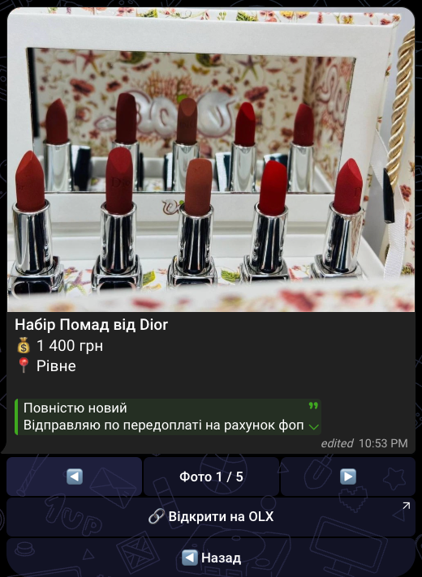

# Pounce 🐾

A Telegram bot that monitors OLX.ua listings for you: search, filter, track new ads and price drops, and keep favorites.

## Що вміє бот

- 🔎 **Пошук на OLX** — напиши, що шукаєш, і гортай оголошення в каруселі.
- 🎯 **Фільтри в Mini App** — ціна, місто, стан товару, сортування, період і точний збіг у назві.
- 🔔 **Стеження** — бот сам перевіряє OLX кожні 15 хвилин.
- 📉 **Сповіщення** про нові оголошення та зниження ціни, **історія цін** кожного оголошення.
- ⭐ **Обране** і «Детальніше» з описом та галереєю фото.
- ❓ **Гайд для нових користувачів** — покрокова інструкція просто в чаті.

<table>
  <tr>
    <td align="center"> Старт</td>
    <td align="center"> Гайд для нових користувачів</td>
    <td align="center"> Пошук і карусель</td>
  </tr>
  <tr>
    <td align="center"> Детальніше: опис і фото</td>
    <td align="center"> Mini App з фільтрами</td>
    <td align="center"> Мої пошуки (стеження)</td>
  </tr>
</table>

## Архітектура

Бот ніколи не ходить на OLX сам: увесь скрапінг ізольований у окремому FastAPI-сервісі, який тримає кеш пошуку й обмежує кількість паралельних запитів, а бот спілкується з ним через `httpx`. Стеження, обране та історія цін лежать у PostgreSQL (для локального запуску достатньо SQLite), схема керується міграціями Alembic. Mini App — статична сторінка на GitHub Pages: форма фільтрів повертає боту JSON через `sendData`.

## Стек

- **Python 3**, **aiogram 3** — Telegram-бот
- **FastAPI** — API-сервіс, **httpx** — клієнт для бота
- **curl_cffi**, **BeautifulSoup** — скрапінг OLX
- **SQLAlchemy 2.0** (+ Alembic) — база даних
- Також: APScheduler (періодичні перевірки), pytest (тести й покриття, CI на GitHub Actions)
